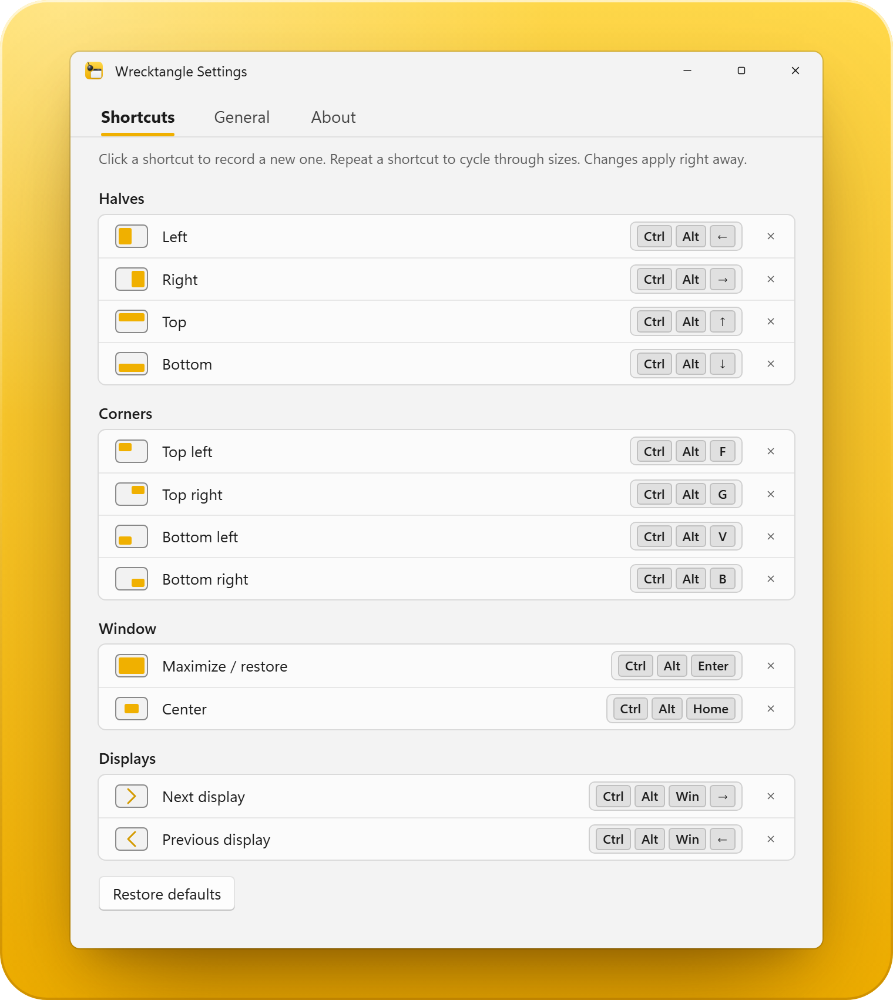

<p align="center">
  
</p>

<h1 align="center">Wrecktangle</h1>

<h3 align="center">Snap windows from the keyboard.</h3>

<p align="center">
  A Rectangle-style window manager for Windows and Linux (X11), written in Rust.<br>
  Send the focused window to a half, a corner or the center with one shortcut, and press it again to change its size.
</p>

<p align="center">
  <a href="https://github.com/zolferfigueiredo/wrecktangle/releases/latest"></a>
  <a href="https://www.rust-lang.org"></a>
  
  
  <a href="LICENSE"></a>
  <a href="https://github.com/zolferfigueiredo/wrecktangle/actions/workflows/ci.yml"></a>
</p>

<p align="center">
  <a href="https://github.com/zolferfigueiredo/wrecktangle/releases/latest"><b>Download for Windows</b></a> (32-bit and 64-bit)
  &nbsp;·&nbsp;
  <a href="#on-linux">Install on Linux</a>
  &nbsp;·&nbsp;
  <a href="https://wrecktangle.zolfer.com">Website</a>
</p>

<p align="center">
  
</p>

## Install

1. [Download the installer](https://github.com/zolferfigueiredo/wrecktangle/releases/download/v0.8.0/Wrecktangle-0.8.0-x64-setup.exe)
   and run it. It installs for your user only, into
   `%LOCALAPPDATA%\Programs\Wrecktangle`, and never asks for admin rights. It
   isn't code signed yet, so if Windows SmartScreen says it protected your PC,
   click **More info**, then **Run anyway**.
2. Tick **Launch at startup** to have Wrecktangle start every time you sign in,
   and **Create a desktop shortcut** if you want one. It runs from the tray.
3. Press Ctrl+Alt+Left. The focused window fills the left half of its screen.
   Press it again for two thirds, and again for three quarters.

Or take the [portable zip](https://github.com/zolferfigueiredo/wrecktangle/releases/download/v0.8.0/Wrecktangle-0.8.0-x64.zip):
put `wrecktangle.exe` somewhere permanent, run it from there, and turn on
**Launch at startup** from the tray menu.

You need Windows 10 or 11. The links above are for 64-bit Windows; on 32-bit
Windows, take the
[32-bit installer](https://github.com/zolferfigueiredo/wrecktangle/releases/download/v0.8.0/Wrecktangle-0.8.0-x86-setup.exe)
or [32-bit zip](https://github.com/zolferfigueiredo/wrecktangle/releases/download/v0.8.0/Wrecktangle-0.8.0-x86.zip)
instead. Uninstall it from Apps in Windows Settings.

### On Linux

Wrecktangle runs on Linux desktops that use X11, and is tested on Xfce
(Linux Mint 22). Wayland is not supported: it doesn't let one app move
another app's windows. Every release has packages for 64-bit PCs (`x86_64`,
`amd64`) and for ARM64 (`aarch64`, `arm64`). Take the one for your system
from the [releases](https://github.com/zolferfigueiredo/wrecktangle/releases):

| System | File | Install it with |
| --- | --- | --- |
| Debian, Ubuntu, Linux Mint | `Wrecktangle-<version>-amd64.deb` | `sudo apt install ./Wrecktangle-<version>-amd64.deb` |
| Fedora, openSUSE | `Wrecktangle-<version>-x86_64.rpm` | `sudo dnf install ./Wrecktangle-<version>-x86_64.rpm`, or `zypper install` |
| Any other | `Wrecktangle-<version>-x86_64.AppImage` | `chmod +x` it, then run it |
| Any, without root | `Wrecktangle-<version>-x86_64-linux.tar.gz` | unpack it, then run `./install.sh` (installs into `~/.local`) |

Then start **Wrecktangle** from the menu, open **Settings…** from its tray
icon and turn on **Launch at startup**. If it was on in another copy, such
as an older install or a build from source, the copy you install takes it
over when it starts. To update, install the newer file the same way;
Wrecktangle tells you when there is one.

To uninstall, run `sudo apt remove wrecktangle` or `sudo dnf remove
wrecktangle`; a running copy quits first and puts back the Xfce shortcuts it
took over. For the `.tar.gz`, run its `./uninstall.sh`. For the AppImage,
turn off **Launch at startup**, quit it from the tray and delete the file.
Your settings stay in `~/.config/wrecktangle`.

To build it from source instead, install Rust with
[rustup](https://rustup.rs), clone this repository and run
`./scripts/install-linux.sh`; `./scripts/uninstall-linux.sh` removes it.

Xfce already uses some of the default shortcuts, such as Ctrl+Alt+Left for
switching workspaces. Wrecktangle takes those over while it runs: it turns
the Xfce shortcut off, and back on when it quits. Settings shows which Xfce
shortcut each one replaces.

**Coming from Wectangle?** Wrecktangle used to be called Wectangle. On its
first start it closes a running Wectangle, copies
`%APPDATA%\Wectangle\config.json` to `%APPDATA%\Wrecktangle\config.json`, and
moves the "Launch at startup" entry to the new exe. The old `wectangle.exe` and
`%APPDATA%\Wectangle` can be deleted afterwards.

## Features

- **One shortcut per spot.** The left, right, top and bottom halves, the four
  corners, the center, and maximize or restore. No dragging, no snap zones.
- **Press again to resize.** Repeating a shortcut steps through a size cycle:
  1/2, 2/3 and 3/4 of the screen by default, or any mix of 1/4, 1/3, 1/2, 2/3
  and 3/4.
- **Every monitor.** Move a window to the next or previous display with a
  shortcut. **Display mode** gives the Windows Project menu (Win+P) a second
  shortcut of your choice that works like Win+P: keep its modifiers held and
  press the key again to move through the options, then let go of the
  modifiers to pick one. On Linux it opens Xfce's display dialog. Its row
  appears once 2 or more screens are connected, and it has no shortcut until
  you set one.
- **Can quiet Windows' Win+Arrow keys.** On Windows, turn on **Block
  Windows' Win+Arrow keys** in Settings and Win+Arrow and Win+Shift+Arrow stop snapping,
  maximizing, minimizing and moving windows. Shortcuts you set on those keys
  still work, and Win+Z is left alone.
- **Lines up exactly.** Sizes use the window's visible frame, so snapped windows
  meet edge to edge without the gap Windows' invisible resize border leaves.
- **Takes over busy shortcuts.** When Windows or another app already owns a
  chord, such as Alt+Win+Left, Wrecktangle takes it over instead of giving up,
  and Settings names the app it overrides, for example "Overrides PowerToys
  Peek". On Linux it does the same with Xfce's own shortcuts, for as long as
  it runs.
- **A Windows 11 style Settings window.** Fluent design, light or dark as you
  choose or as the system is, in the system's accent color or with optional
  yellow highlights like the logo. Change any shortcut, the size cycle or
  launch at startup, and every change applies as you make it. On Linux the
  tray icon is white or black to match the theme, like the panel's own icons.
- **Speaks 12 languages.** Deutsch, English, Español, Français, Italiano,
  Polski, Português, Русский, Українська, 中文, 日本語 and 한국어. The first run
  follows the system's display language, and **Language** in Settings switches
  Settings, the tray menu and notifications at once.
- **Keeps itself up to date.** It checks GitHub once a day or on demand. The
  installed Windows copy updates itself while **Install updates
  automatically** is on; otherwise, and on Linux, a notification links to the
  download.
- **No admin rights.** Unless the window you want to move runs as administrator
  (see [Limitations](#limitations)).
- **Lives in the tray.** Opening it again while it runs brings up Settings
  instead of a second copy.

## Default shortcuts

| Action | Default |
| --- | --- |
| Left (full height) | Ctrl+Alt+Left |
| Right (full height) | Ctrl+Alt+Right |
| Top (full width) | Ctrl+Alt+Up |
| Bottom (full width) | Ctrl+Alt+Down |
| Top-left | Ctrl+Alt+F |
| Top-right | Ctrl+Alt+G |
| Bottom-left | Ctrl+Alt+V |
| Bottom-right | Ctrl+Alt+B |
| Maximize / restore | Ctrl+Alt+Enter |
| Center | Ctrl+Alt+Home |
| Next display | Ctrl+Alt+Win+Right |
| Previous display | Ctrl+Alt+Win+Left |
| Display mode | Not set |

Every shortcut can be changed in Settings, from the tray icon. On Linux, Win
is the Super key, and Settings calls it Super.

## How it works

<details>
<summary><b>Shortcut takeover</b></summary>

Wrecktangle first asks Windows to register each shortcut. When another app, or
Windows itself, already owns one, Wrecktangle takes it over with one global
low-level keyboard hook, installed only while at least one shortcut needs it.
While the hook is on, the taken-over chord triggers Wrecktangle's action and is
hidden from the owner and from the focused app. Settings shows the status as
"Overrides <app>".

The hook is also on while **Display mode** has a shortcut. It turns that
chord into a held Win+P for as long as its modifiers stay down, which is what
lets repeated presses move through the menu. And it is on while **Block
Windows' Win+Arrow keys** is, to swallow those chords before Windows acts on
them.

- Win+L and Ctrl+Alt+Del are handled by Windows below the hook, so they
  cannot be taken over. Settings shows "Reserved by Windows" for them.
- The owner name comes from the other app's own hotkey settings (PowerToys,
  Twinkle Tray, the NVIDIA overlay, the Claude desktop Quick Entry shortcut),
  from a table of built-in Windows chords, and, marked "probably", from
  Windows Magnifier and the default Claude shortcut while those apps run.
  Only hotkey fields are read; tokens and other settings in those files are
  ignored.
- The hook runs on Wrecktangle's UI thread. If that thread stalls, Windows can
  stop calling the hook, and taken-over shortcuts stop working until
  Wrecktangle restarts.

On Linux, Wrecktangle grabs each shortcut from the X server. When Xfce
already holds one, Wrecktangle removes that Xfce shortcut with
`xfconf-query`, notes it in `~/.config/wrecktangle/xfce-takeover.json` and
grabs the chord. It puts every one back when it quits, including on logout,
and at the next start after a crash; the uninstall script does too. A chord
another app holds can't be taken over, and Settings says "In use by another
app". Ctrl+Alt+F1 to F12 and Ctrl+Alt+Backspace belong to the X server.

</details>

<details>
<summary><b>Updates</b></summary>

Wrecktangle asks `api.github.com` for the latest release of this repository 30
seconds after it starts, if 24 hours have passed since the last check, and
then every 24 hours. When a newer version exists:

- The installed Windows copy downloads the new installer, checks it against
  the release's `SHA256SUMS`, runs it and starts again, while **Install
  updates automatically** is on. Otherwise, and for the portable copy, a
  notification links to the installer.
- On Linux, clicking the notification downloads the same kind of file you
  installed from, for your processor: the `.deb`, the `.rpm`, the AppImage,
  or the `.tar.gz` for a copy in `~/.local`. Install it the same way. A
  copy that runs from anywhere else, such as a build, opens the release
  page.

**Betas.** A beta, a version such as 0.9.0-beta.1, asks for every release,
so it hears about newer betas and releases. Every other copy asks only for
the latest release, which GitHub never sets to a beta, so it never hears
about one.

Turn the automatic check off with "Check for updates automatically" in the
App section of Settings. The tray menu's "Check for updates..." and the
"Check for updates..." button on About check on demand.

</details>

<details>
<summary><b>The settings file</b></summary>

Settings are stored at `%APPDATA%\Wrecktangle\config.json`, or on Linux at
`~/.config/wrecktangle/config.json` (the same format). It holds the size
cycle, the shortcut assigned to each action, `language` (a two letter code),
`theme` (`system`, `light` or `dark`; default `system`),
`wrecktangle_colors` (default `false`), `block_windows_snap` (default
`false`), `check_updates` (default `true`) and
`last_update_check` (a Unix time in seconds, maintained by Wrecktangle).

Edit it through the Settings window; a hand-edited file that fails to parse
falls back to defaults with a notification, and is left untouched until you
change something in Settings.

</details>

## Limitations

- **Linux needs X11.** Wayland sessions are not supported. Xfce is tested;
  other window managers that follow the EWMH standard should work, but
  only Xfce's shortcuts can be taken over.

- **Admin windows.** Windows running as administrator cannot be moved by a
  non-elevated Wrecktangle, because of UIPI. Wrecktangle detects this up front
  and shows a one-time notification instead of failing silently.
- **Display mode with an admin window focused.** Windows keeps the keyboard
  hook from seeing keys while an administrator window has focus, so the
  **Display mode** shortcut only opens the menu then, and pressing it again
  does not move through the options. Blocked Win+Arrow keys work as usual
  there too.
- **AltGr note.** On a US-International keyboard layout, Ctrl+Alt+<key> is
  the same key chord as AltGr+<key>. Assigning a shortcut that way can block
  typing that key's AltGr character anywhere else. The Settings window flags
  any shortcut that does this.
- **Default keys also used elsewhere.** A few defaults overlap with shortcuts
  some other programs already use:
  - **Magnifier**, while it is running: Ctrl+Alt+Arrows, F, Enter.
  - **VS Code**: Ctrl+Alt+Up/Down add cursors.
  - **JetBrains IDEs**: Ctrl+Alt+Left/Right navigate back and forward.

  Change any of these from the Settings window if they conflict with how you
  work.

## Build from source

Needs a stable Rust toolchain (see `rust-toolchain.toml`; rustup installs it
automatically), the MSVC "Desktop development with C++" build tools, and a
Windows 10 SDK, since the build links against Win32 and embeds an icon and
manifest.

```
cargo build --release
target\release\wrecktangle.exe
```

On Linux you only need Rust, since every dependency is written in Rust.
`./run.sh` makes a debug build and (re)starts Wrecktangle, and
`./run.sh --foreground` keeps it in the terminal with its output.

Double-click `run.bat` to make a debug build of whatever changed and (re)start Wrecktangle, or
`build.bat` to only build it. Both close a running Wrecktangle first, since it
locks the exe. `installer.bat` builds the installer,
`dist\Wrecktangle-<version>-x64-setup.exe`; it needs Inno Setup 6
(`winget install JRSoftware.InnoSetup`).

Want to help? [CONTRIBUTING.md](CONTRIBUTING.md) covers setup, checks,
translations and pull requests.

The repository ships a pre-commit hook that refuses commits on `main`, checks
formatting and rejects em or en dashes in `src/*.rs`. Turn it on once after
cloning:

```
git config core.hooksPath .githooks
```

**Release.** It takes two steps; `release.bat` needs git, `gh` signed in and
cargo, and `-DryRun` shows what it would do:

1. `release.bat 0.4.1` opens a pull request into `dev` that bumps the version
   to 0.4.1 in `Cargo.toml`, `Cargo.lock`, and this README's release badge and
   download links (CI fails while they differ).
2. Once that is merged, merge `dev` into `main`. The Release workflow sees a
   version on `main` with no release yet, publishes it and tags the merged
   commit `v0.4.1`.

A version with a pre-release part, such as `release.bat 0.9.0-beta.2`, is a
beta: the README's badge and links stay on the latest release, and the
Release workflow publishes it as a GitHub pre-release, which only betas hear
about.

Double-clicking `release.bat` publishes the version on `main` by hand if it
isn't released yet (it checks that CI passed, asks you to confirm and pushes
the tag), and otherwise asks for the next version. On a tag, the Release
workflow checks it against `Cargo.toml` and refuses one that isn't on `main`.
Either way it runs the tests and builds `wrecktangle.exe` for 64-bit and
32-bit Windows on a Windows runner with MSVC, packs each into a zip and an
Inno Setup installer, and publishes a GitHub release named
"Wrecktangle <version>" with:

- `Wrecktangle-<version>-x64-setup.exe` and `Wrecktangle-<version>-x64.zip`
  (64-bit)
- `Wrecktangle-<version>-x86-setup.exe` and `Wrecktangle-<version>-x86.zip`
  (32-bit)
- for Linux, built on Ubuntu runners for both architectures from one
  staged tree (`packaging/linux/stage.sh`): `Wrecktangle-<version>-amd64.deb`
  and `Wrecktangle-<version>-x86_64.rpm` (made with nfpm from
  `packaging/linux/nfpm.yaml`), `Wrecktangle-<version>-x86_64.AppImage`
  (appimagetool) and `Wrecktangle-<version>-x86_64-linux.tar.gz`, and the
  same four for `arm64` and `aarch64`
- `SHA256SUMS` for every file, and `latest.json` with the version and the
  Windows zips' SHA-256

Running the workflow by hand, or a pull request that changes it or
`installer/`, builds the same files without publishing and uploads them as a
workflow artifact.

**CI** checks every pull request on Linux, cross-compiling for Windows:
`cargo fmt --check`, `cargo test`, Clippy with warnings as errors for Linux
and both Windows architectures, and release builds uploaded as workflow
artifacts, `Wrecktangle-<version>-x64.exe` and `Wrecktangle-<version>-x86_64-linux`.

<details>
<summary><b>Developer overrides</b></summary>

- `WRECKTANGLE_THEME=light` or `dark` forces the theme of the Settings window
  and menus, and of the Linux tray icon, over the Theme setting.
- `WRECKTANGLE_UPDATE_URL` replaces the GitHub releases API URL for the update
  check, so a local server can stand in for GitHub. Plain `http://` is
  accepted only through this variable.

</details>

<details>
<summary><b>Icon</b></summary>

`assets/wrecktangle.svg` is the logo, and `assets/wrecktangle-16.svg` to
`-32.svg` are pixel-snapped versions for the tray and title bar sizes. After
changing any of them, run `cargo run --example make_icon` to render them into
`wrecktangle.ico` and the 256 px PNG on the About page.

</details>

## License

Wrecktangle is released under the [MIT License](LICENSE).

## Credits

- Inspired by [Rectangle](https://rectangleapp.com) by Ryan Hanson, the macOS
  window manager. Wrecktangle is an independent Windows app, not affiliated
  with Rectangle.

---

<p align="center">
  If Wrecktangle is useful to you, please consider giving it a ⭐<br>
  It helps other Windows users find it. Thank you!
</p>

<p align="center">
  Made with ❤️ by <a href="https://zolfer.com">zolfer.com</a>
</p>
